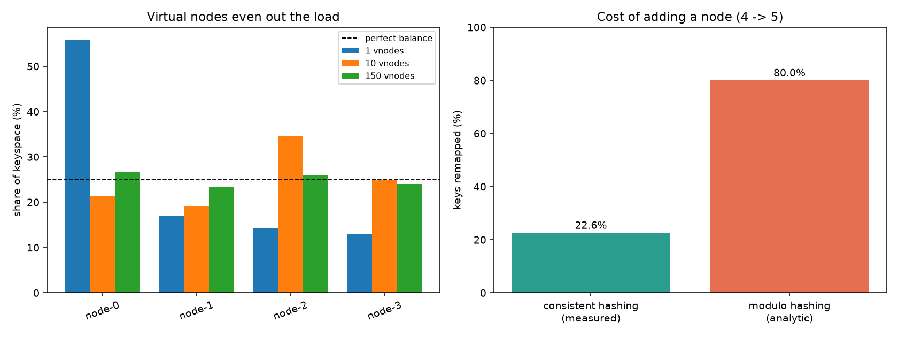
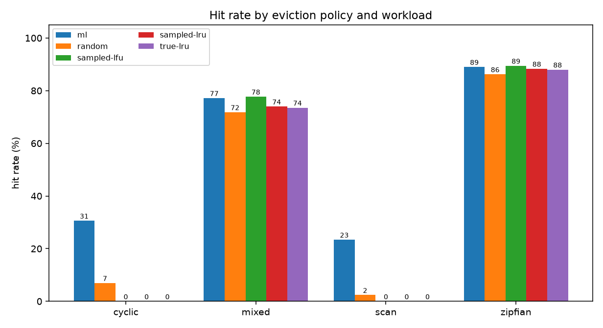

# Evict

A Redis-compatible in-memory cache built from scratch in Python with
`asyncio` — RESP over TCP, event-loop concurrency, a consistent-hash
cluster, crash recovery via write-ahead logging, and a learned eviction
policy benchmarked honestly against the classical ones.

Real `redis-cli` and `redis-benchmark` drive it unmodified.

---

## Architecture

```
                    ┌─────────────────────────────────────────┐
                    │            ClusterClient                │
                    │  hash(key) -> ring -> owning node       │
                    │  one connection per node, no proxy      │
                    └───────┬──────────┬──────────┬───────────┘
                            │          │          │
                  RESP/TCP  │          │          │
              ┌─────────────┘          │          └─────────────┐
              ▼                        ▼                        ▼
    ┌──────────────────┐     ┌──────────────────┐     ┌──────────────────┐
    │     node-0       │     │     node-1       │     │     node-2       │
    │ ┌──────────────┐ │     │                  │     │                  │
    │ │ asyncio loop │ │     │      (same)      │     │      (same)      │
    │ │ 1 coroutine  │ │     │                  │     │                  │
    │ │ per conn     │ │     └──────────────────┘     └──────────────────┘
    │ └──────┬───────┘ │
    │        ▼         │      Per node, the request path:
    │ ┌──────────────┐ │
    │ │ RESP parse   │ │        read() ──► parse ──► stage to WAL
    │ │ (framing)    │ │                                 │
    │ └──────┬───────┘ │                                 ▼
    │        ▼         │                            apply to store
    │ ┌──────────────┐ │                                 │
    │ │  dispatch    │ │                                 ▼
    │ └──────┬───────┘ │                        await durability
    │        ▼         │                                 │
    │ ┌──────────────┐ │                                 ▼
    │ │    store     │ │                          encode ──► write()
    │ │  LRU / LFU   │ │
    │ │  / learned   │ │      Background coroutines:
    │ └──────┬───────┘ │        · WAL commit loop (fsync in executor)
    │        ▼         │        · snapshot writer (incremental, yields)
    │ ┌──────────────┐ │        · active TTL expiry sweep
    │ │ WAL + snapshot│ │
    │ └──────────────┘ │
    └──────────────────┘
```

Four independent pieces, each with its own document:

| Piece | Where | Notes |
|---|---|---|
| RESP protocol + framing | `cache/resp.py` | [NETWORKING.md](NETWORKING.md) §1–2 |
| Event-loop concurrency | `cache/server.py` | [DESIGN.md](DESIGN.md) |
| Consistent-hash cluster | `cache/hashring.py`, `cache/cluster.py` | [NETWORKING.md](NETWORKING.md) §4 |
| WAL + snapshots | `cache/wal.py`, `cache/snapshot.py` | [NETWORKING.md](NETWORKING.md) §5 |
| Eviction + ML | `cache/eviction.py`, `cache/ml_policy.py` | below |

---

## Headline results

All measured on this machine (M-series MacBook Air, macOS 14, Python 3.11).

### Throughput

Measured with `redis-benchmark -n 10000`, the real Redis client:

| | SET | GET |
|---|---:|---:|
| **This cache** (Python, single-threaded) | ~100,000/s | ~120,000/s |
| Real Redis 8.8.0 (C), same machine | 215,517/s | 221,239/s |
| Real Redis, pipelined `-P 16` | 1,562,500/s | 2,127,660/s |

Within ~2× of C Redis from pure Python, single-threaded. Run-to-run
variance is a few percent, so these are rounded rather than reported to the
digit. The pipelining row is why the parser had to handle many commands per
read in the first place.

### Durability modes (8 concurrent clients)

| mode | writes/sec |
|---|---:|
| `always`, no group commit | 9,195 |
| `always`, **group commit** | **22,535** (2.5×) |
| `everysec` | 59,771 |

At one client the group-commit speedup is 1.0× — nothing to batch, which is
the control that shows the 2.5× is real batching rather than noise.

**200/200 `kill -9` crash-recovery cycles pass** (100 per mode, 453,075
acknowledged writes verified). `always` guarantees every acknowledged write
survives the kill; `everysec` guarantees the log is never corrupt and
recovery yields a clean prefix of the write sequence — the two claims are
asserted separately, because they are genuinely different guarantees.

### Consistent hashing (200,000 keys, 4 nodes)

| | max/min load | keys moved when a 5th node joins |
|---|---:|---:|
| 1 virtual node | 4.30× | — |
| **150 virtual nodes** | **1.14×** | **22.6%** (1/N ideal = 20%) |
| modulo hashing | 1.00× | ~80% |



### Eviction policies — hit rate (200k accesses, 1 MB budget, 5 repeats)

| policy | cyclic | mixed | scan | zipfian |
|---|---:|---:|---:|---:|
| **learned (ML)** | **26.47%** | 74.71% | **19.13%** | 88.55% |
| random | 6.99% | 71.80% | 2.42% | 86.23% |
| sampled-lfu | 0.02% | **76.33%** | 0.00% | **89.13%** |
| sampled-lru | 0.00% | 73.33% | 0.00% | 88.02% |
| true-lru | 0.00% | 73.53% | 0.00% | 87.99% |



**Read this table honestly.** The learned policy wins enormously where LRU
is pathological — on `cyclic` and `scan`, LRU scores exactly **0%**, because
every key is evicted just before its next use. It reaches 26.5% against a
theoretical ceiling of 29.1% (capacity ÷ cycle length).

It **loses** to sampled-LFU on both `mixed` and `zipfian`, the two workloads
that most resemble real traffic. On the friendly cases, counting accesses is
simply hard to beat, and a model does not earn its cost.

It also is not free:

| | per eviction | eviction-heavy throughput |
|---|---:|---:|
| true-lru | ~0.5 µs | ~1,100 kops/s |
| learned | ~50 µs | ~18 kops/s |

Inference runs **only at eviction** — never on `GET`/`SET`. There is a test
asserting that reads and non-evicting writes trigger zero predictions.

---

## Running it

```bash
# setup (once)
python3.11 -m venv venv && source venv/bin/activate
pip install numpy lightgbm xxhash pytest matplotlib scikit-learn
brew install redis libomp          # redis-cli/benchmark; libomp for lightgbm

# single node — then talk to it with real redis-cli
python -m cache.server --port 6390 --capacity 10000
redis-cli -p 6390 SET foo bar
redis-cli -p 6390 GET foo
redis-cli -p 6390 INFO

# with persistence
python -m cache.server --port 6390 --data-dir ./data --fsync everysec

# with the learned eviction policy
python -m cache.server --port 6390 --eviction ml --model models/mixed.txt

# 3-node cluster
python tools/launch_cluster.py --nodes 3 --data-root ./data

# the full demo (cluster, load, kill -9, WAL recovery) — narrated
./demo.sh

# tests
pytest -q

# reproduce every benchmark
./validate.sh                                   # redis-cli + redis-benchmark
python tools/bench_fsync.py                     # durability modes
python tools/crash_test.py --iterations 100     # kill -9 recovery
python tools/plot_distribution.py               # hash ring balance
python tools/run_experiments.py                 # traces, training, eviction study
```

Every generator is seeded and every result file is written with the config
that produced it, so the numbers above are reproducible.

---

## Limitations

Stated plainly, because most of them are deliberate scope decisions rather
than oversights.

- **Memory is bounded by key count, not bytes.** `--capacity` counts keys.
  The eviction *benchmark* converts a byte budget into a per-policy key
  count, but the server itself does not track real memory. A workload with
  wildly varying value sizes would blow past any intended footprint.
- **No replication.** Each shard is a single point of failure for its own
  keys. A dead shard errors cleanly and recovers from its own WAL, but until
  it comes back, its slice of the keyspace is unavailable. No failover.
- **Static cluster membership.** Adding a node changes where keys are looked
  up, not where data lives — there is no live migration, so a join
  effectively invalidates the keys that moved. `hashring` supports
  `add_node`/`remove_node`; wiring that to online resharding is the missing
  piece.
- **Cache warmth is lost on recovery.** The WAL restores *data*, but recency
  and frequency statistics start from scratch, so a recovered node evicts
  badly until its access history rebuilds.
- **Single-machine benchmarks.** Every number here was measured with client
  and server on one host over loopback. Real network latency, packet loss,
  and NIC limits are entirely absent, which flatters the throughput figures
  and completely hides partition behaviour.
- **A small command set.** `GET`, `SET` (with `EX`/`PX`/`EXAT`/`PXAT`),
  `DEL`, `EXISTS`, `TTL`, `PTTL`, `PING`, `INFO`. No hashes, lists, sets,
  transactions, pub/sub, or `SCAN`.
- **The learned policy is trained per workload.** Each model is fitted to
  one traffic shape. A single model applied across all four does markedly
  worse — an early version did exactly that and lost, because "older means
  further from reuse" is correct on Zipfian traffic and exactly backwards on
  a cycle. Online adaptation is not implemented.
- **`__len__` counts expired-but-uncollected keys.** Matching Redis's
  `DBSIZE`; use `GET`/`TTL` for expiry-accurate answers.
- **No auth, no TLS.** Bind to localhost.

---

## Documents

- [DESIGN.md](DESIGN.md) — where the request path yields, and why the store
  needs no locks
- [NETWORKING.md](NETWORKING.md) — mapping from project parts to networking
  concepts
- [NOTES.md](NOTES.md) — Phase 0 exploration: real RESP bytes captured off
  the wire, and the baseline Redis benchmarks
