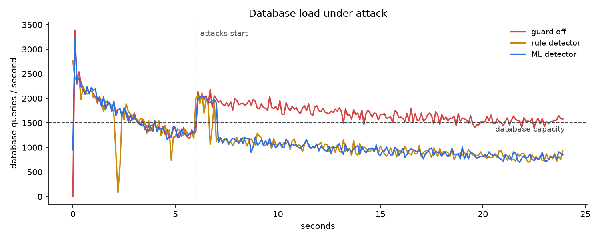

# Security: an attack-aware cache

The cache defends itself at the **protocol level**: it authenticates and
encrypts connections, and it watches each connection's traffic for four
attacks, flagging them with either hand-written rules or a trained model and
mitigating what it flags. Code: `cache/security.py`, `cache/guard.py`;
tooling: `tools/traffic.py`, `tools/train_guard.py`, `tools/bench_guard.py`.

---

## Threat model

A cache port reachable by clients that are not all trusted: a multi-tenant
cache, a service mesh, or an instance exposed to the internet. Exposed,
unauthenticated Redis ports are a well-known target, scanned for and
hijacked by botnets. The attacker can open TCP connections and speak RESP.

Out of scope: an attacker with the password (that is a compromised client,
not an outsider), attacks on the host itself, and volumetric floods below
the application layer (SYN floods belong to the kernel and the network).

## The four attacks and the defence against each

| Attack | What the attacker does | Detection signal | Mitigation |
|---|---|---|---|
| **Unauthorized access** | Connects and reads, writes or wipes data | — | `--requirepass` (AUTH) and `--tls-cert/--tls-key` (TLS 1.2+) |
| **Password brute force** | Guesses AUTH passwords | failed AUTHs per connection | doubling per-IP delay on failures; disconnect after 10; guard disconnects after 3 |
| **Cache penetration** | GETs keys that exist nowhere, so every request misses and becomes a database query | high miss ratio, every key distinct, no writes | rate-limit the connection to 20 commands/s |
| **Hot-key flood** | Hammers one or a few keys at very high rate, overloading the node that owns them | very high rate, one key dominates | rate-limit to 200 commands/s |
| **Slowloris** | Holds connections open with a command that never finishes | partial command, no progress for several windows | disconnect; `--max-conns-per-ip` caps how many it can hold |

The pre-existing hardening still applies underneath: oversized values and
argument counts are rejected on the declared length, and the per-connection
query buffer is capped (`DESIGN.md`, "Hardening").

## Access control

**AUTH** follows Redis's own protocol, so `redis-cli -a` works unchanged:
`-NOAUTH Authentication required.` before authentication, `-WRONGPASS ...`
for a bad password, `AUTH <password>` and `AUTH default <password>` both
accepted. The comparison is constant-time (`hmac.compare_digest`), so reply
timing does not reveal how much of a guess was right.

Brute-force resistance is keyed by IP but applied only to **failed**
attempts: each failed AUTH from an IP doubles the delay before that reply
(0.1 s, 0.2 s, 0.4 s, ... capped at 2 s), decaying by half every 30 s, and
the tenth failure on one connection closes it. Legitimate clients often
share an IP (everything on localhost does, and so does everything behind a
NAT), and one that authenticates correctly is never delayed. An earlier
version kept the delay per connection, and the first end-to-end run showed
the flaw: disconnecting a guesser handed it a fresh, short delay on
reconnect.

**TLS** uses Python's `ssl` with a minimum of TLS 1.2; in practice clients
negotiate TLS 1.3. `tools/make_certs.sh` creates a local certificate
authority and a server certificate it signs, so clients verify the server
against `certs/ca.pem` — real chain verification, not "accept anything".
`redis-cli --tls --cacert certs/ca.pem` connects; a plaintext client is
refused; a client that does not trust the CA rejects the server.

## The guard

### Where it sits

Every command updates a few counters on its connection (`ConnStats.record`):
command type, whether a GET missed, whether the reply was an error, and the
key, in a table capped at 2,048 distinct keys per window. Once a second a
background coroutine closes every connection's window into a feature row,
classifies all rows in one batch, and updates each connection's verdict.
Nothing heavier than a dict update ever runs per command, and model
inference never does.

A refused command is still **recorded** as attempted, so throttling an
attacker never makes its traffic look calmer than it is — otherwise the
guard would release it as soon as it started working.

### Features (one definition, shared with the trainer)

`cache.guard.feature_row` is imported by both the server and
`tools/train_guard.py`, so training and serving cannot compute features
differently — the same rule the learned eviction policy follows.

| Feature | Meaning |
|---|---|
| `rate` | commands per second |
| `get_ratio`, `set_ratio` | command mix |
| `miss_ratio` | GETs answered "no such key" |
| `distinct_ratio` | distinct keys / keyed commands |
| `top_key_share` | share of keyed commands on the busiest key |
| `error_ratio` | error replies / commands |
| `auth_failures` | failed AUTHs this window |
| `bytes_per_cmd` | request bytes per command |
| `pending_bytes` | bytes of an incomplete command held at window end |
| `stalled_windows` | consecutive windows with a partial command trickling under 64 bytes |

### Two detectors on the same rows

- **Rules** — thresholds an operator would write: ≥ 3 auth failures; ≥ 3
  stalled windows; ≥ 50 req/s with ≥ 90% misses and ≥ 80% distinct keys;
  ≥ 3,000 req/s with one key ≥ 50% of traffic.
- **ML** — a LightGBM multiclass classifier trained on labelled windows.
  It flags only at ≥ 80% confidence.

A verdict lifts only after 3 consecutive normal windows, so it does not flap
on one quiet second. `GUARD MODE off|observe|rules|ml` switches detectors at
runtime; `GUARD STATUS` reports every connection's verdict as JSON.

### Making the evaluation mean something

A detector tested against obvious attacks and quiet traffic scores perfectly
and proves nothing. So every attack has a **legitimate look-alike** in the
traffic mix (`tools/traffic.py`):

| Attack | Legitimate twin | What they share | What separates them |
|---|---|---|---|
| penetration | **warmer**, a cache warm-up job | almost every GET misses, keys never repeat | the warmer SETs what it misses |
| hot_flood | **viral**, a genuinely popular key; **busy**, a high-rate service | one dominant key; very high rate | rate *and* concentration together |
| slowloris | **idle**, a connection that sends nothing | no completed commands | slowloris holds a partial command |

Train and test windows come from **separate collection runs with different
seeds**, never a split of one run. A third run, **stealth**, uses attack
intensities below anything in training, to show where detection fails
rather than only where it works.

## Measured results

Reproduce with:

```bash
python tools/train_guard.py     # collect, train, evaluate: ~12 minutes
python tools/bench_guard.py     # end-to-end, guard off vs rules vs ML: ~90 s
```

### Detection on held-out traffic

Recall per attack (share of that attack's one-second windows flagged). The
ML model was trained on 2,817 windows from 16 sessions and tested on runs
with different seeds. **Stealth** attacks are weaker than anything in
training: penetration at 5–50 req/s (trained on 50–2,000), floods at
1,500–4,000 req/s (trained on 4,000–15,000). Both detectors go through the
same action policy the server applies (below).

| | ML, test | Rules, test | ML, stealth | Rules, stealth |
|---|---:|---:|---:|---:|
| penetration | 97.8% | 97.8% | **95.6%** | **0%** |
| hot_flood | 100% | 96.7% | **96.7%** | 23.3% |
| brute_force | 75.8%\* | 75.8%\* | 66.7%\* | 66.7%\* |
| slowloris | 100% | 80.3% | 100% | 81.8% |
| **legitimate windows flagged** | **0 of 658** | 0 of 658 | **1 of 777** | 0 of 777 |

\* By design: the first two failed AUTHs on a connection are never acted
on (see the policy below), so those windows count as misses here. What
matters for brute force is how many guesses get through, measured end to
end.

Rules and ML tie on attacks at full strength. The model's advantage is
**low-intensity attacks**: rules key on fixed rate thresholds, and a
penetration attack at 20 req/s sits under them entirely. Slowloris rules
need three stalled windows by design; the model flags from the first. The
model's one false alarm in 777 legitimate stealth windows was a 1 MB
uploader window labelled slowloris.

Supports are small for some classes — 45 penetration windows per test set —
so these are strong results on a small test, not a guarantee.

### The action policy

One window cannot tell a user's typo from a guesser's first attempt: both
are a lone failed AUTH. Measured, the model called a single failed AUTH
brute force at 99.9% confidence. A brute_force verdict disconnects, so it
needs at least 3 failed AUTHs on the connection before it is acted on — the
same bar the rule detector uses (`cache.guard.apply_policy`). The model
detects; the policy decides when acting is safe.

### End to end: all four attacks at once against a real server

24-second run, 11 legitimate clients (including every look-alike and a user
who mistypes the password), attacks from t = 6 s. Same scenario three times.

| | Guard off | Rules | ML |
|---|---:|---:|---:|
| Penetration queries reaching the database | 13,440 | 1,001 | **1,097** (−92%) |
| Flood requests served | 160,600 | 11,614 | **12,314** (−92%) |
| Passwords tried | 40 | 36 | 36 |
| Slowloris connections closed | 0 | 100 | 100 |
| Time to detect penetration / flood | – | 0.95 s | 0.97 s |
| Time to detect brute force | – | 2.95 s | 2.98 s |
| Time to detect slowloris | – | 3.95 s | **0.97 s** |
| **Legitimate requests refused** | 0 / 216,724 | **0 / 212,430** | **0 / 216,860** |
| Legitimate p99 latency | 1.55 ms | 1.52 ms | 1.47 ms |



Brute force is held down by the **per-IP backoff**, not by the detector:
about 40 guesses in 18 seconds with the guard off, because every failed
AUTH from that IP waits up to 2 s. Disconnecting a guesser after 3 failures
removes it from the server but barely changes the guess rate, since it
reconnects into the same per-IP backoff.

### What the evaluation caught along the way

Each of these was found by measuring, and fixed before the numbers above:

1. **A suspiciously perfect first model.** Its top features showed it had
   learned shortcuts: brute force via `error_ratio` (no legitimate client
   ever got an error) and slowloris via `pending_bytes` alone (none sent
   large values). Two look-alikes were added — a buggy client and a 1 MB
   uploader. Retraining moved the model onto `auth_failures`, the causal
   signal; neither look-alike is falsely flagged.
2. **An unfair rule.** "≥ 3 auth failures in one second" almost never fires,
   because the backoff itself slows guessing to about one a second. That
   made ML look better than it deserved. Replaced with "≥ 3 failures on the
   connection", and rules brute-force recall went from 14.5% to 97.3%.
3. **The guard made brute force worse.** The first end-to-end run let 220
   guesses through with the guard on against 64 with it off: disconnecting
   a guesser reset its per-connection backoff, so reconnecting was rewarded.
   Backoff is now per IP, applied only to failed attempts.
4. **Throttling made attackers look innocent.** Refused GETs were counted
   as non-misses, so a throttled penetration attacker's miss ratio fell, it
   was released, resumed, and was flagged again — reaching the database
   about 4,000 times instead of about 1,100. Ratios are now computed only
   over commands that actually ran.
5. **A gap in the test set.** Random attack selection left one test run with
   no penetration at all; attacks now rotate so every collection has every
   attack.
6. **A typo got a user disconnected.** In the dashboard, one wrong password
   during an attack closed the connection: the model labelled a single
   failed AUTH brute force at 99.9%. No legitimate client in the traffic had
   ever mistyped a password, so the evaluation never saw it. A `typo`
   client was added (and windows are now labelled by connection, so a
   window logged before the client named itself is labelled correctly), and
   the action policy above was introduced. An earlier end-to-end figure of
   "4 passwords tried with ML" came from this over-eager model and is
   withdrawn.

## Limitations

- **Synthetic traffic.** Both the attacks and the legitimate clients are
  generated. The look-alikes make the test harder than "attack vs quiet",
  but a real deployment's normal traffic would contain shapes neither
  detector has seen.
- **Per-connection identity.** An attacker who spreads a campaign thinly
  across many connections looks, per connection, like many small clients.
  `--max-conns-per-ip` bounds this for direct attackers; it cannot help when
  every client arrives through one proxy or NAT.
- **An adaptive attacker** who knows the features can stay under them: a
  penetration attack at a few requests a second, or one that SETs junk
  after each miss to mimic a warmer. Rate limiting still bounds the damage
  a detected attacker can do, but an undetected one is unbounded by
  construction. The stealth evaluation measures how quickly that happens.
- **Mitigation is per connection.** A disconnected attacker can reconnect;
  it is caught again within a few windows, but there is no IP ban, because
  banning by IP locks out everyone who shares that IP.
- **No ACL users.** One password for everyone, as Redis's `requirepass`.
